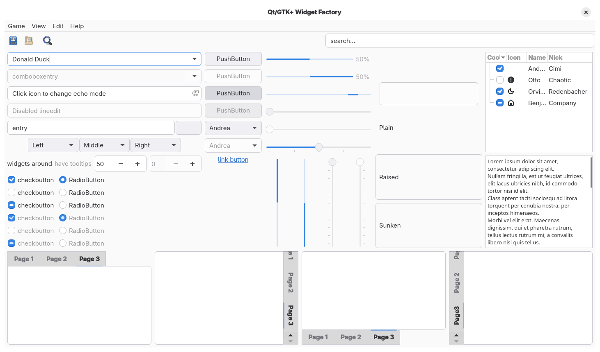
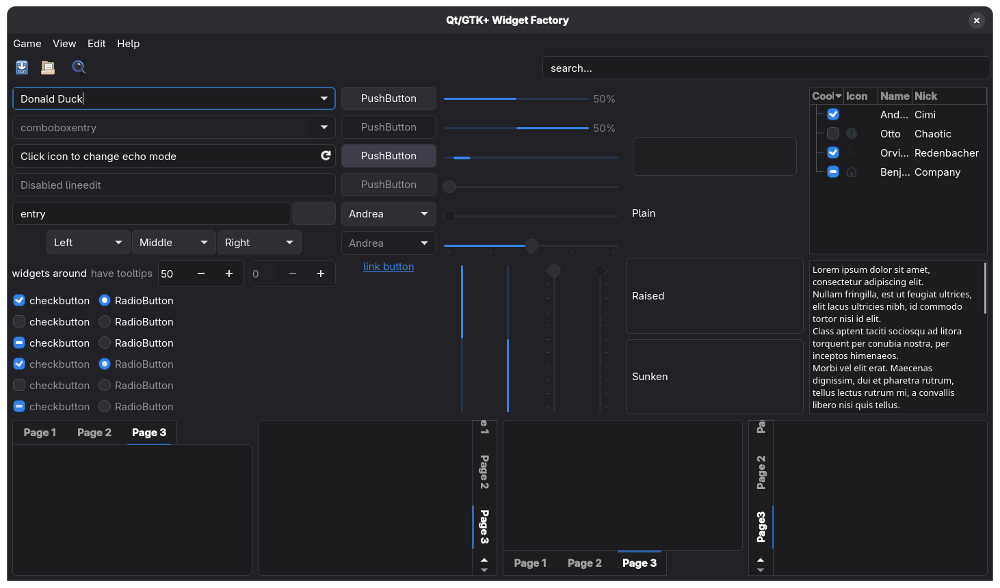
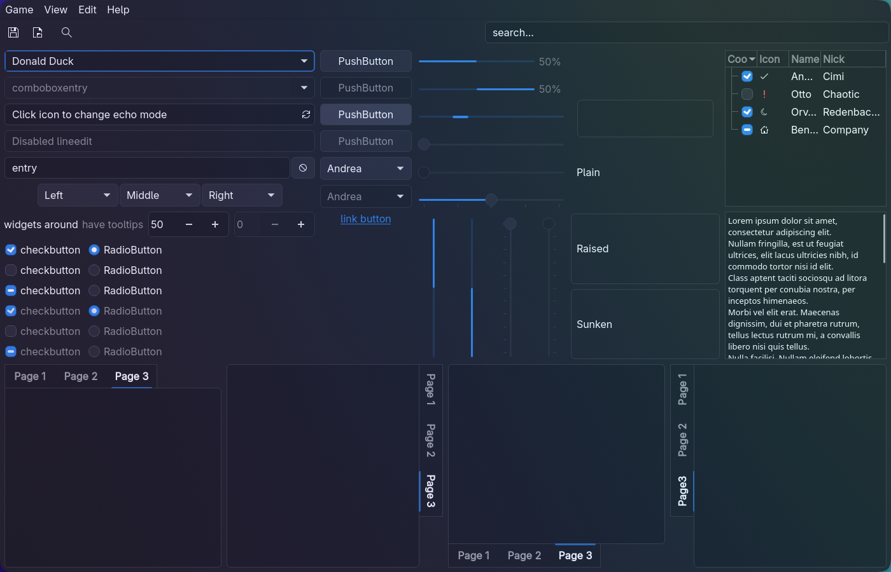
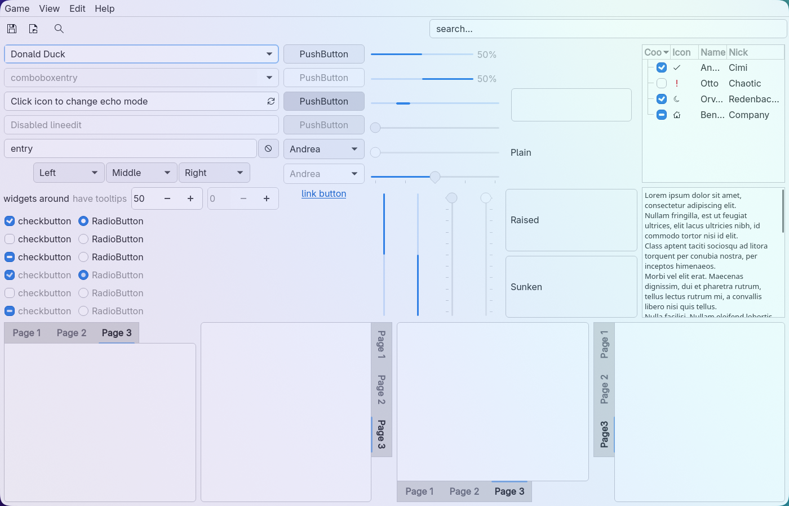

libadwaita-qt
=============

A Qt5/Qt6 widget style that makes Qt applications look like modern GNOME
(libadwaita) apps — flat headers and tabs, the libadwaita color palette and the
Adwaita blue accent — and follows the system light/dark preference live.

### GNOME





### Hyprland (translucent windows with blur)





## Features

* **libadwaita colors** — window, view, header and sidebar colors taken from
  current libadwaita instead of the old GTK3 Adwaita palette.
* **Automatic light/dark** — the `libAdwaita` style reads
  `org.freedesktop.appearance color-scheme` from the XDG desktop portal and
  switches running applications as soon as the preference changes.
  No restart, no per-mode configuration.
* **Flat libadwaita look** — reworked header bars, tabs and views.
* Works on any desktop with an XDG portal (GNOME, Hyprland, Sway, …), on Wayland and X11.

## Styles

| Style key          | Variant                                  |
|--------------------|------------------------------------------|
| `libAdwaita`       | follows the system color scheme (recommended) |
| `libAdwaita-Light` | always light                             |
| `libAdwaita-Dark`  | always dark                              |

## Building

Dependencies: CMake, Qt 6.2+ (or Qt 5.15.2+) with Core, DBus, Gui and Widgets.

```sh
cmake -S . -B build -DUSE_QT6=ON -DCMAKE_INSTALL_PREFIX=/usr -DCMAKE_BUILD_TYPE=Release
cmake --build build
sudo cmake --install build
```

Drop `-DUSE_QT6=ON` to build for Qt5. Add `-DBUILD_EXAMPLE=ON` to build the
`showcase` widget gallery used for the screenshots above.

The stylesheets in `src/lib/stylesheet/processed` are the reference colors.
`-DREGENERATE_STYLESHEETS=ON` rebuilds them from the SCSS sources with `sassc`,
but those sources are outdated and produce the old GTK3 Adwaita colors.

## Usage

### GNOME

Set the style for your session and log in again:

```sh
mkdir -p ~/.config/environment.d
echo 'QT_STYLE_OVERRIDE=libAdwaita' > ~/.config/environment.d/qt-style.conf
```

### Other desktops

Outside of GNOME and KDE Plasma the easiest way is [qt6ct](https://github.com/trialuser02/qt6ct)
(and qt5ct for Qt5 apps):

1. Set `QT_QPA_PLATFORMTHEME=qt6ct` in your environment.
2. In qt6ct choose the **libAdwaita** style and the **default palette**
   (`custom_palette=false`). A custom palette overrides the style's colors
   and breaks automatic light/dark switching.

To try it on a single application:

```sh
some-qt-app -style libAdwaita
```

KDE Frameworks apps (Dolphin, Kate, …) also apply the color scheme from
`~/.config/kdeglobals` on top of the style, so they may not match.

## Credits

This is a fork of [FedoraQt/adwaita-qt](https://github.com/FedoraQt/adwaita-qt)
by Martin Bříza, Jan Grulich and contributors, which is no longer maintained.
All the groundwork is theirs.

## License

LGPL-2.1 / GPL-2.0, same as upstream — see [LICENSE.LGPL2](LICENSE.LGPL2)
and [LICENSE.GPL2](LICENSE.GPL2).
